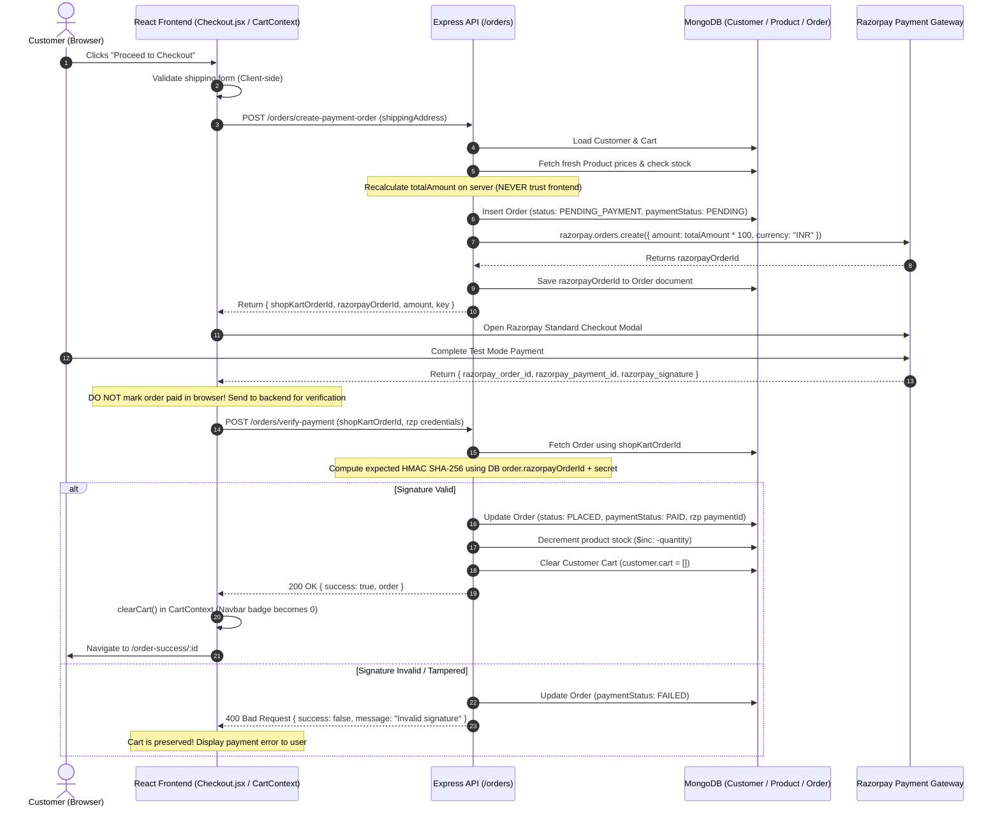

# 🛒 ShopKart Lab 06 — Checkout, Razorpay Integration & Order Management
## Master Engineering Reference & Viva Preparation Guide

---

## 1. 🏗️ High-Level System Architecture

In an e-commerce platform, the cart is **temporary, mutable, and customer-controlled state**, whereas an order is a **permanent, immutable, legally binding business record**.

### End-to-End Request/Response Journey



---

## 2. 🧠 Core Engineering Principles & Trade-offs

### A. Purchase-Time Product Snapshot vs. Document Reference

* **WHAT:** When an order is placed, we do not simply store `{ product: ObjectId }`. We copy (`snapshot`) the current `name`, `price`, `image`, and `quantity` directly into each `item` subdocument within the `Order`.
* **WHY IT EXISTS:** In an e-commerce platform, merchants change product titles, update descriptions, and raise or lower prices regularly. If an order only held a reference to the `Product` collection:
  1. A keyboard purchased for ₹2,999 today would show as ₹3,499 next month if the merchant increased the price.
  2. If the merchant deleted the product from the catalog, `order.items[0].product` would resolve to `null`, corrupting past tax records, invoices, and customer order history.
* **HOW IT WORKS:**
  ```javascript
  orderItems.push({
    product: product._id,
    name: product.name,       // Immutable historical snapshot
    price: product.price,     // Immutable historical snapshot
    quantity: cartItem.quantity,
    image: product.image,
  });
  ```
* **TRADE-OFF:** Denormalization slightly increases MongoDB storage size per order, but guarantees **zero historical price drift** and **100% auditing compliance**.

---

### B. Server-Side Price & Stock Revalidation

* **WHAT:** The client sends **only the shipping address** in `POST /orders/create-payment-order`. The backend looks up the customer's cart, queries the latest `Product` documents in MongoDB, verifies available stock, and calculates `totalAmount`.
* **WHY IT EXISTS:**
  1. **Price Tampering:** Any user with Chrome DevTools can alter React state or intercept an HTTP request to set `totalAmount: 1`. If the server trusts client totals, users could buy ₹10,000 items for ₹1.
  2. **Race Conditions & Stale Inventory:** An item added to cart 3 days ago might have only 2 units left, but another user may have purchased them 10 seconds ago. Revalidating stock at the moment of order initiation prevents overselling.
* **HOW IT WORKS:**
  ```javascript
  for (const cartItem of customer.cart) {
    const product = await Product.findById(cartItem.product);
    if (!product) throw new Error("Item no longer available");
    if (product.stock < cartItem.quantity) {
      return res.status(400).json({ 
        message: `Insufficient stock for ${product.name}. Only ${product.stock} available.` 
      });
    }
    calculatedTotal += product.price * cartItem.quantity;
  }
  ```

---

### C. Razorpay Test Mode & Cryptographic HMAC SHA-256 Verification

* **WHAT:** Standard Checkout requires two steps:
  1. Backend initiates a Razorpay Order (`razorpay.orders.create`) and receives `razorpay_order_id`.
  2. Frontend opens the payment modal. When completed, Razorpay supplies a cryptographic signature. The backend verifies this signature using `HMAC_SHA256`.
* **WHY AMOUNTS ARE IN PAISE:**
  * Financial systems avoid floating-point math because of IEEE 754 precision issues (e.g., `0.1 + 0.2 = 0.30000000000000004`).
  * Razorpay requires amounts in the smallest currency unit: `₹1 = 100 paise`. An order of ₹7,497 becomes integer `749700`.
* **WHY THE KEY SECRET IS NEVER SENT TO FRONTEND:**
  * The Key Secret is the master signature key for your payment account. Exposing it in React bundle allows any malicious user to forge signatures or initiate refunds.
* **HOW SIGNATURE VERIFICATION WORKS:**
  Razorpay computes:
  $$\text{Signature} = \text{HMAC-SHA256}(\text{razorpay\_order\_id} + "|" + \text{razorpay\_payment\_id},\; \text{key\_secret})$$
  On the backend:
  ```javascript
  const trustedRazorpayOrderId = order.razorpayOrderId;
  const body = `${trustedRazorpayOrderId}|${razorpay_payment_id}`;
  const expectedSignature = crypto
    .createHmac("sha256", process.env.RAZORPAY_KEY_SECRET)
    .update(body)
    .digest("hex");

  if (expectedSignature !== razorpay_signature) {
    order.paymentStatus = "FAILED";
    await order.save();
    return res.status(400).json({ message: "Invalid payment signature" });
  }
  ```
* **CRITICAL SECURITY DETAIL:** The backend uses `order.razorpayOrderId` stored in its own database, not the `razorpay_order_id` passed in the request body. This prevents order substitution attacks.

---

### D. Cart Clearing Timing & Global State Synchronization

* **RULE:** The user's cart must **NEVER** be cleared when:
  * The user clicks "Proceed to Checkout"
  * The checkout form is validated
  * The Razorpay modal opens
  * Payment fails or is cancelled
* **WHY:** If a payment gateway times out or declines a card, clearing the cart forces the customer to find and add all products again, causing cart abandonment.
* **WHEN:** The cart is cleared in MongoDB **ONLY AFTER** `crypto` successfully verifies the HMAC signature.
* **FRONTEND SYNC:**
  * As soon as `/orders/verify-payment` returns `200 OK`, React calls `clearCart()` from `CartContext`.
  * This updates the global React state in memory, instantly resetting the Navbar badge `Cart (0)` without requiring a full page refresh.

---

### E. Multi-Tenant Authorization & IDOR Protection

* **VULNERABILITY (IDOR):** Insecure Direct Object Reference occurs when an endpoint accepts an ID (e.g., `GET /orders/:id`) and returns the document without checking whether the authenticated user owns it.
* **DEFENSE:**
  ```javascript
  const order = await Order.findById(id);
  if (!order) return res.status(404).json({ message: "Order not found" });

  if (order.customer.toString() !== req.customerId) {
    return res.status(403).json({ message: "Forbidden: You do not own this order" });
  }
  ```

---

## 3. 📁 File Architecture & Responsibilities

| File Path | Role & Responsibilities |
|---|---|
| `backend/models/order.model.js` | Defines the Mongoose Order schema with product snapshot fields, shipping address, status enums, indexes, and customer reference. |
| `backend/config/razorpay.js` | Initializes the Razorpay Node SDK using `RAZORPAY_KEY_ID` and `RAZORPAY_KEY_SECRET`. |
| `backend/controllers/order.controller.js` | Implements server-side price calculation, inventory stock checks, Razorpay order generation, HMAC SHA-256 signature verification, cart clearing, and order retrieval. |
| `backend/routes/order.routes.js` | Declares protected endpoints (`POST /orders/create-payment-order`, `POST /orders/verify-payment`, `GET /orders`, `GET /orders/:id`, `PATCH /orders/:id/status`). |
| `frontend/src/context/CartContext.jsx` | Exposes global cart state and provides `clearCart()` to synchronize UI badge and items list upon verified order creation. |
| `frontend/src/pages/Checkout.jsx` | Renders shipping address form with field-level validation, loads Razorpay Standard Checkout SDK, and calls verification API. |
| `frontend/src/pages/OrderSuccess.jsx` | Displays order confirmation screen with purchase breakdown, snapshot prices, fulfillment status, and delivery destination. |
| `frontend/src/pages/Orders.jsx` | My Orders history page with loading spinner, empty state, order cards, and status tags. |
| `frontend/src/pages/OrderDetails.jsx` | Dedicated single order view featuring a visual 4-step fulfillment tracker and bonus lifecycle progression controls. |
| `frontend/src/components/Navbar.jsx` | Updated with a direct link to `Orders` and dynamic cart count badge. |
| `backend/tests/lab06_verification.test.js` | Automated test suite verifying address validation, server pricing rules, stock limits, HMAC signature security, and ownership authorization. |

---

## 4. 🎤 Strict Examiner Viva Questions & Answers

### Payment Architecture

#### Q1: Why must the Razorpay order be created on the backend instead of directly from React?
**Answer:** The Razorpay Orders API requires authentication using your `RAZORPAY_KEY_SECRET`. The secret key must never exist in frontend code because any visitor can view client-side JavaScript. Creating the order on the backend also guarantees that our server controls and validates the exact monetary amount before registering it with the payment gateway.

#### Q2: What are `razorpay_order_id`, `razorpay_payment_id`, and `razorpay_signature`?
**Answer:**
1. `razorpay_order_id`: The identifier generated by Razorpay's server when our backend initiated the payment session.
2. `razorpay_payment_id`: The transaction reference generated when the customer completed the payment modal.
3. `razorpay_signature`: An HMAC-SHA256 hex digest generated by Razorpay using our shared secret key. It proves that the payment was processed by Razorpay for that specific order without tampering.

#### Q3: What happens if a malicious client sends `paymentSuccess: true` to the backend?
**Answer:** The backend completely ignores any client-supplied booleans. The order status is transitioned to `PAID` only when the cryptographic HMAC SHA-256 hash computed by `crypto.createHmac` matches the signature provided by Razorpay.

#### Q4: Why does Razorpay require amounts in paise instead of rupees?
**Answer:** Floating-point numbers in programming languages (IEEE 754) are prone to rounding errors (e.g., `0.1 + 0.2 = 0.30000000000000004`). Financial systems avoid floating-point calculations by representing all currencies in their smallest atomic denomination (paise for INR, cents for USD).

---

### Data Modeling & Integrity

#### Q5: Why do we snapshot the product's name and price into the Order schema rather than just storing `productId` and referencing `Product`?
**Answer:** E-commerce catalogs are mutable. Merchants frequently update prices, rebrand items, or delete outdated products. If an order only referenced the Product document:
1. Historical invoices would drift whenever catalog prices change.
2. Deleting a product would break the order details view (resulting in `null` pointer exceptions or missing data).
Snapshotting preserves an immutable contract of what the customer agreed to buy at that exact timestamp.

#### Q6: Why must stock be checked again during checkout if we already checked it when adding to cart?
**Answer:** Time-of-check to time-of-use (TOCTOU). A user may keep items in their cart for hours or days. In the meantime, other shoppers may purchase the remaining inventory. Validating stock at the exact moment of order creation prevents negative inventory balances and overselling.

#### Q7: How does idempotent payment verification work, and why is it needed?
**Answer:** If a user experiences a slow network connection, they may click "Retry" or the client might send multiple verification requests for the same transaction. The controller checks `if (order.paymentStatus === "PAID") return res.status(200).json(...)`. This prevents deducting product stock multiple times or throwing duplicate key errors.

---

### Security & Access Control

#### Q8: How do you prevent User A from viewing User B's order?
**Answer:** In `getOrderById`, we verify ownership using the authenticated user's ID from the JWT cookie:
```javascript
if (order.customer.toString() !== req.customerId) {
  return res.status(403).json({ message: "Forbidden" });
}
```
Even if User A guesses the MongoDB `_id` of User B's order, the API rejects the request with HTTP 403 Forbidden.

#### Q9: Why is the Razorpay order ID taken from MongoDB rather than `req.body.razorpay_order_id` during HMAC signature calculation?
**Answer:** If the backend used `req.body.razorpay_order_id`, an attacker who completed a ₹10 order on their own account could take that valid order ID, payment ID, and signature, and submit them against an expensive ₹50,000 pending order. By forcing the HMAC input to use the `order.razorpayOrderId` saved in MongoDB, we guarantee that the signature matches the exact order being fulfilled.

---

### React & State Management

#### Q10: Why must `CartContext` be updated in memory immediately upon verified payment?
**Answer:** In single-page applications (SPAs), page changes do not trigger a full browser reload. If we clear the cart only in the database, the Navbar cart badge and local cart state remain populated until the user manually refreshes the page. Calling `clearCart()` updates React state synchronously with the database mutation.

#### Q11: What should happen if a user opens `/checkout` with an empty cart?
**Answer:** The checkout page checks `cartItems.length === 0`. It displays an empty-cart warning with a link to the catalog and disables order placement. The backend also validates `customer.cart.length === 0` and returns `400 Bad Request` to protect against direct API calls.
